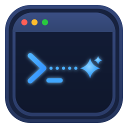
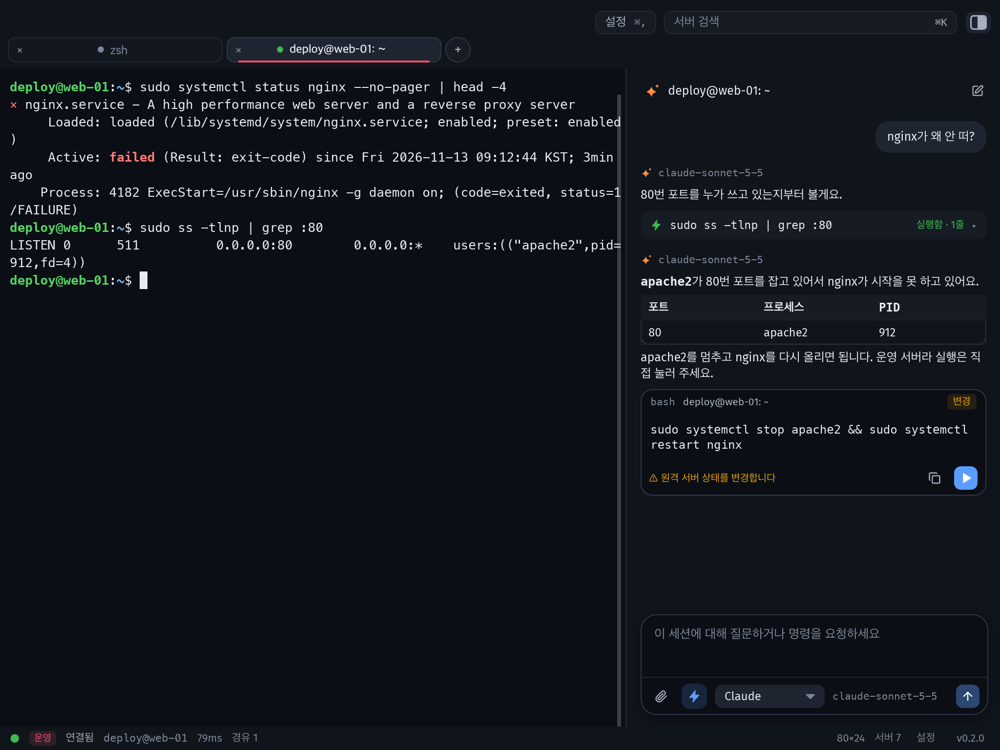
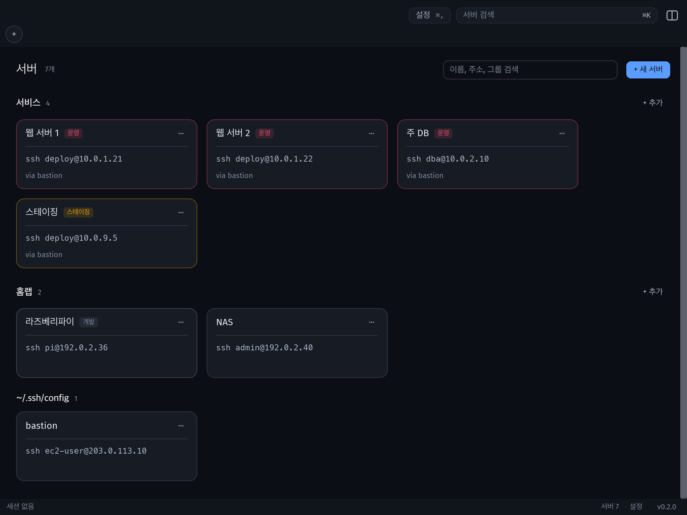
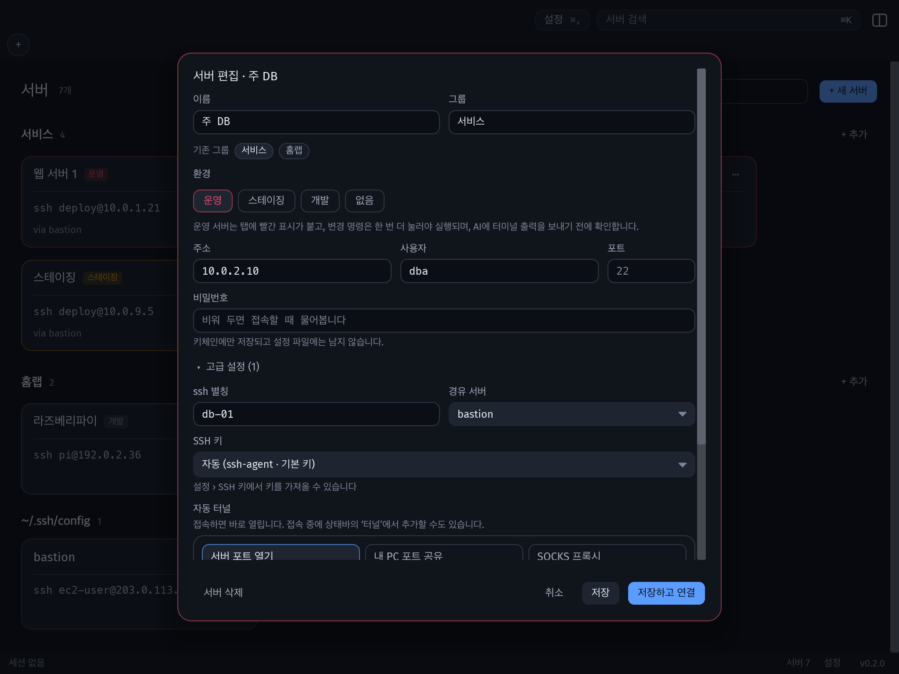
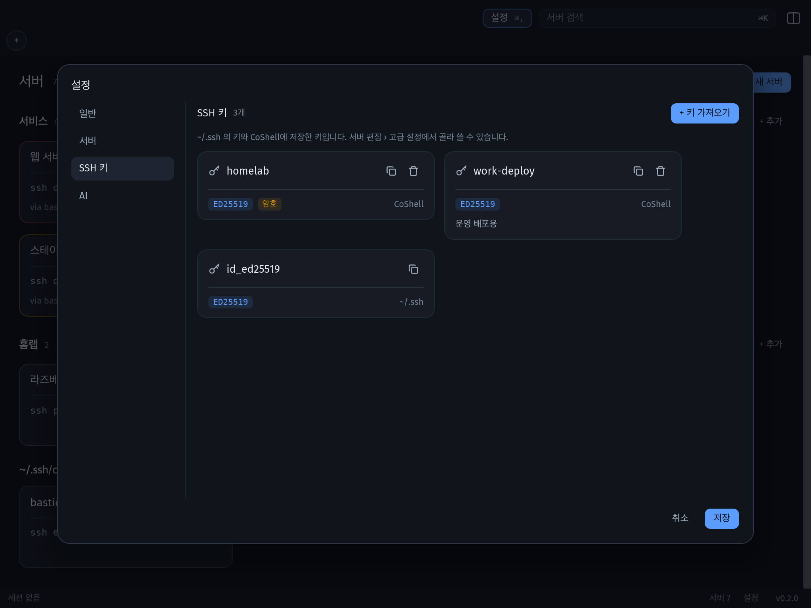
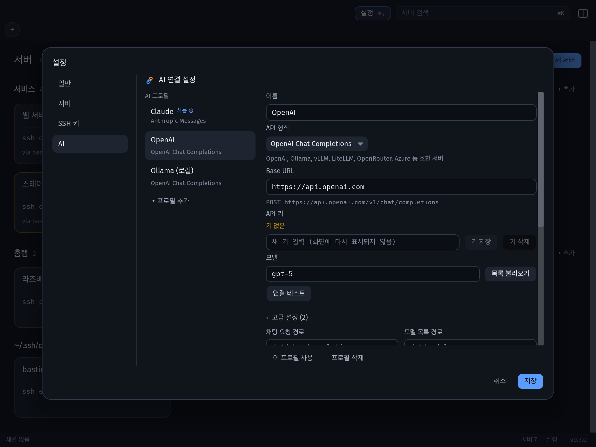

<div align="center">



# CoShell

**AI와 같이 쓰는 SSH 터미널**

서버 접속, 포트 터널, SSH 키, 그리고 옆자리 동료처럼 같이 보고 설명해 주는 AI를
터미널 하나에 담았습니다.

[](LICENSE)


</div>



> "nginx가 왜 안 떠?" 하고 물으면 AI가 **보고 있는 그 터미널**에 확인 명령을 입력하고,
> 화면에 나온 결과를 읽은 뒤 원인과 해결 방법을 알려 줍니다. 바꾸는 명령은 사람이 누를 때만 실행됩니다.

---

## 왜 CoShell인가요

터미널 작업은 대부분 **확인 → 해석 → 조치**의 반복입니다. 그동안은 명령을 검색해서 붙여 넣고,
출력을 복사해 AI 채팅에 다시 붙여 넣어야 했습니다. CoShell은 그 왕복을 없앴습니다.

- **같이 보는 AI.** AI가 조회 명령을 직접 실행합니다. 실행은 내 터미널 화면에서 그대로 보입니다.
- **말로 하는 서버 관리.** "목록 보여줘", "용량", "nginx 상태" 정도면 충분합니다. 되묻지 않고 알아서 합니다.
- **사고를 막는 기본값.** 운영 서버, 위험한 명령, 비밀 값이 각각 따로 보호됩니다.
- **흩어진 도구를 한곳에.** 서버 목록, 경유 서버, 포트 터널, SSH 키를 앱 안에서 관리합니다.

## 주요 기능

###  같이 일하는 AI 도우미

- **직접 확인하고 설명합니다.** ⚡ 모드(기본)에서는 AI가 읽기 전용 명령을 터미널에 입력하고 결과를 읽습니다.
  채팅에는 `⚡ ls -al · 실행함 · 14줄` 한 줄만 남고, 누르면 출력이 펼쳐집니다.
- **대화하듯 답합니다.** 결과를 요약하고, 필요하면 표로 정리한 뒤 다음 할 일을 제안합니다.
- **명령은 하나씩.** 대안을 줄줄이 늘어놓지 않고, 사용자가 말한 이름을 그대로 써서 바로 실행할 수 있는 명령 하나를 줍니다.
- **바꾸는 명령은 사람이 실행합니다.** 변경·위험 명령은 위험도 배지와 함께 ▶ 버튼으로만 실행됩니다.
- **어떤 모델이든.** Anthropic(Claude) 형식과 OpenAI 형식을 모두 지원합니다.
  OpenAI, Ollama, vLLM, LiteLLM, OpenRouter, Azure, DeepSeek 같은 호환 서버도 연결할 수 있습니다.

###  운영 서버를 위한 안전장치

| 상황 | CoShell의 동작 |
|---|---|
| 조회 명령 (`df -h`, `ss -tlnp`) | AI가 바로 실행 |
| 변경 명령 (`systemctl restart`, `apt upgrade`) | ▶를 눌러야 실행하고, **운영 서버에서는 한 번 더 확인** |
| 위험 명령 (`rm -rf`, `kill -9`, `DROP TABLE`) | 어디서든 두 번 눌러야 실행 |
| 끝나지 않는 명령 (`top`, `tail -f`, `watch`) | AI가 자동으로 실행하지 않음 |
| 입력 중이거나 다른 프로그램 실행 중 | AI가 끼어들지 않음 |
| 출력에 섞인 API 키·비밀번호 | `••••••••`로 가린 뒤 AI에 전송 |
| 운영 서버의 터미널 출력 | AI에 보내기 전에 한 번 더 확인 |

AI가 혼자 이어서 실행하는 명령은 질문 하나당 최대 4번이고, 20초가 지나면 기다리지 않습니다.

### 서버 관리



- 서버를 **그룹**(서비스, 홈랩 등)과 **환경**(운영 / 스테이징 / 개발)으로 묶습니다. 운영 서버는 탭과 카드에 빨간 표시가 붙습니다.
- **경유 서버(ProxyJump)** 를 고르기만 하면 여러 단계 접속이 됩니다.
- `~/.ssh/config`의 서버도 함께 보입니다. 이 파일은 읽기만 하고 수정하지 않습니다.
- ⌘K 한 번으로 서버를 검색하고 바로 접속합니다.

###  블록처럼 맞추는 포트 터널



`L:3306:localhost:3306` 같은 문법은 몰라도 됩니다.

1. **목적을 고릅니다.** 서버 포트 열기 / 내 PC 포트 공유 / SOCKS 프록시
2. **서비스를 고릅니다.** MySQL, PostgreSQL, Redis 같은 칩을 누르면 포트가 채워집니다.
3. **확인합니다.** "이 PC에서 localhost:3306으로 접속하면 서버의 3306으로 연결됩니다"처럼 풀어서 보여 줍니다.

서버에 저장해 두면 접속할 때마다 자동으로 열리고, 접속 중에는 상태바의 '터널'에서 바로 추가할 수 있습니다.

### SSH 키 보관함



- `~/.ssh`의 키와 CoShell에 저장한 키를 카드로 보여 줍니다. 키 유형(ED25519 등)과 암호 여부도 함께 표시됩니다.
- **키 가져오기**에서는 파일을 고르거나 내용을 붙여 넣습니다. 공개 키는 자동으로 채워지고, 암호는 키체인에만 저장됩니다.
- 서버 편집 화면에서는 경로를 입력하지 않고 **목록에서 키를 고릅니다**.
- 공개 키 복사 버튼으로 서버의 `authorized_keys`에 바로 붙여 넣을 수 있습니다.

###  AI 연결을 원하는 대로



프로필마다 형식(Anthropic / OpenAI), 주소, 모델, 키를 따로 둡니다. 프록시나 호환 서버를 쓴다면 **고급 설정**을 엽니다.

- 요청 경로 바꾸기, 또는 전체 URL 지정 (예: Azure `?api-version=…`)
- 키 전달 방식: `x-api-key` / `Authorization: Bearer` / 원하는 헤더 이름 / 보내지 않음
- 추가 헤더, 최대 토큰, temperature, `anthropic-version`
- 요청 본문에 합칠 추가 JSON (예: `thinking`, `reasoning_effort`)

API 키는 설정 파일이 아니라 OS 키체인에 저장됩니다.

### 터미널 기본기

탭(⌘⇧←/→로 순서 변경, 클릭해서 이름 변경), 텍스트 선택·복사, 출력 검색, vim·tmux 마우스 지원,
⌘ 클릭으로 링크 열기, 색 구성·글꼴·커서 모양 설정, 한국어·영어 UI를 지원합니다.

---

## 시작하기

Rust(edition 2024)가 필요합니다.

```bash
git clone https://github.com/softkr/CoShell.git
cd CoShell
cargo run -p coshell-app --release                 # 로컬 셸로 시작
cargo run -p coshell-app --release -- ssh my-host   # 등록한 서버나 ~/.ssh/config의 서버로 바로 접속
```

### macOS 앱으로 설치

```bash
scripts/bundle-macos.sh    # target/release/bundle/CoShell.app (기본은 로컬용 ad-hoc 서명)
scripts/package-dmg.sh     # CoShell-<버전>.dmg
```

배포용은 `COSHELL_SIGN_IDENTITY`를 지정해 번들을 만든 뒤 `scripts/notarize-macos.sh`로 공증합니다.
자세한 내용은 각 스크립트 상단 주석을 참고하세요.

### 업데이트

앱을 켤 때와 10분마다 새 릴리스가 있는지 확인합니다. 새 버전이 있으면 상태바에 `⬆ 0.x.x 업데이트`가 나타나고,
누르면 DMG를 내려받아 **릴리스 노트의 SHA-256과 대조한 뒤** 앱을 바꾸고 다시 시작합니다.
해시가 맞지 않거나 릴리스 노트에 해시가 없으면 설치하지 않습니다.

### AI 연결 (1분)

1. ⌘, → **AI** → 사용할 프로필 선택 (Claude / OpenAI / Ollama, 또는 `+ 프로필 추가`)
2. API 키 입력 → **키 저장** → **연결 테스트**
3. ⌘L로 AI 패널을 열고 물어보세요. 입력창 아래 ⚡가 켜져 있으면 AI가 직접 확인합니다.

Ollama처럼 내 컴퓨터에서 돌리는 모델은 키 없이 쓸 수 있습니다.

## 단축키 (macOS)

| 키 | 동작 |
|---|---|
| ⌘K | 서버 검색 · 명령 |
| ⌘O | 서버 목록 |
| ⌘T / ⌘W | 새 로컬 셸 / 탭 닫기 |
| ⌘1–9, ⌘⇧[ / ⌘⇧] | 탭 선택, 이전 / 다음 탭 |
| ⌘⇧← / ⌘⇧→ | 탭 순서 변경 |
| ⌘L | AI 패널 열기 / 닫기 |
| ⌘F, ⌘G / ⌘⇧G | 출력 검색, 이전 / 다음 결과 |
| ⌘C / ⌘V | 복사 / 붙여넣기 |
| ⌘+ / ⌘− / ⌘0 | 글꼴 크기 |
| ⌘, | 설정 (일반 · 서버 · SSH 키 · AI) |
| ⌘ 클릭 | 링크 열기 |

활성 탭을 한 번 더 클릭하면 이름을 바꿀 수 있습니다.

## 데이터와 개인정보

| 내용 | 위치 |
|---|---|
| 서버 목록 | `~/.config/coshell/hosts.toml` |
| 설정 · 창 상태 | `~/.config/coshell/settings.toml` |
| AI 프로필 | `~/.config/coshell/ai.toml` |
| 가져온 SSH 키 | `~/.config/coshell/keys/` (소유자만 읽기, 0600) |
| 서버 비밀번호 · 키 암호 · API 키 | OS 키체인 (파일에는 저장하지 않음) |

- `~/.ssh/config`와 `~/.ssh`의 키는 읽기만 합니다. `known_hosts`에는 호스트 키를 신뢰해서 저장할 때만 씁니다.
- 터미널 출력은 AI가 직접 실행한 명령의 결과이거나 사용자가 📎로 첨부한 경우에만 AI로 전송되고, 그 전에 비밀 값을 가립니다.
- 텔레메트리는 없습니다. 네트워크 요청은 접속하는 서버, 직접 설정한 AI 주소, 그리고 업데이트 확인용 GitHub(`api.github.com`, 10분마다 최신 릴리스 조회)로만 갑니다. 업데이트 확인은 설정 › 일반에서 끌 수 있습니다.

## 구조

| 크레이트 | 역할 |
|---|---|
| `coshell-term` | 터미널 에뮬레이터 코어 (alacritty_terminal), 로컬 PTY |
| `coshell-ssh` | SSH 접속, 경유 체인, 호스트 키 검증, 키 인증, 포트 포워딩 |
| `coshell-ai` | Anthropic · OpenAI 형식 클라이언트, 프로필, 비밀 값 마스킹 |
| `coshell-app` | iced UI 애플리케이션 |

```bash
cargo test --workspace
```

README 이미지는 데모 데이터로 앱 화면을 그려서 만듭니다. 같은 이름의 파일이 있으면 비교만 하므로,
`*-wgpu.png`가 없는 상태에서 실행한 뒤 이름에서 `-wgpu`를 떼어 냅니다.

```bash
COSHELL_README_DIR="$PWD/docs/images" cargo test -p coshell-app readme_screenshots -- --ignored
for f in docs/images/*-wgpu.png; do mv "$f" "${f%-wgpu.png}.png"; done
```

## 라이선스

[Apache-2.0](LICENSE)
